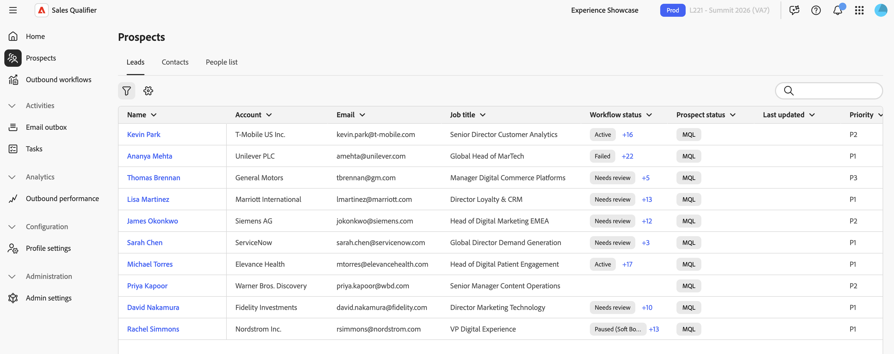
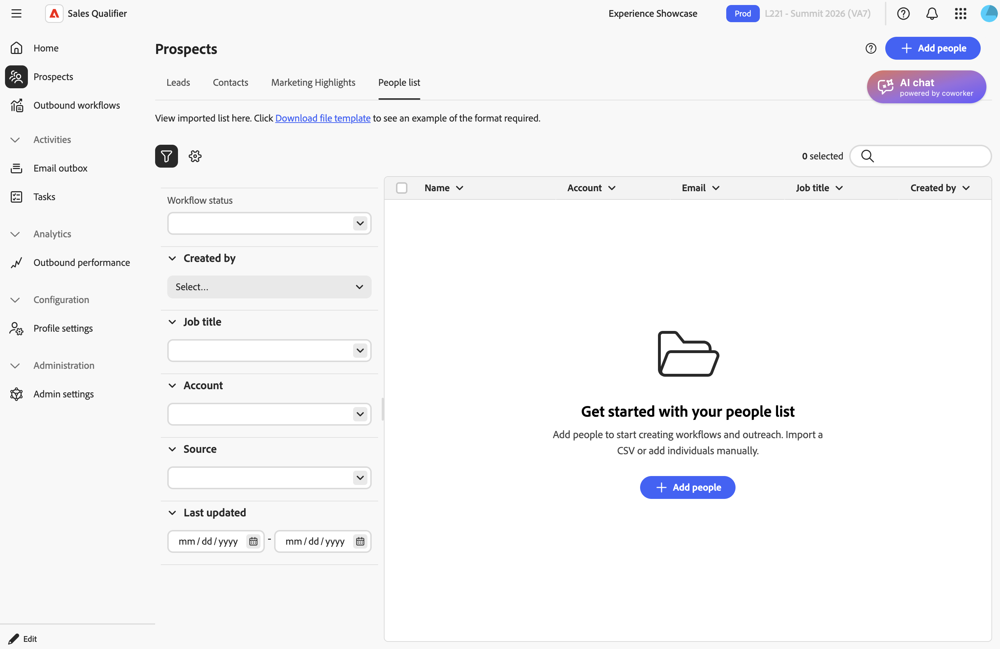

# Prospects

Um die Leads und Kontakte anzuzeigen, auf die Sie zugreifen können, wählen Sie **[!UICONTROL linken Navigationsbereich]** Interessenten“ aus. In der Liste können Sie den Status und die letzte Aktivität jedes Interessenten überprüfen.

{width="800" zoomable="yes"}

* **[!UICONTROL Leads]** Leads, die Ihnen im verbundenen CRM zugewiesen sind.
* **[!UICONTROL Kontakte]** Kontakte, die Ihnen im verbundenen CRM zugewiesen sind, mit ihrem zugehörigen Konto. Die Kontaktdaten enthalten auch den Namen des Inhabers. Diese Details sind für Salesforce und Microsoft Dynamics 365 verfügbar.
* **[!UICONTROL Marketing-Highlights]** Interessenten mit Live-Marketo-Aktivität, wie z. B. Öffnungen oder Klicks von E-Mails.
* **[!UICONTROL Personenliste]** Interessenten, die Sie manuell importieren oder hinzufügen.

## Interessentenkontext überprüfen und Liste exportieren

Die Liste potenzieller Kundinnen und Kunden fasst zusammen, ob zusätzlicher Kontext für personalisierte Kontaktaufnahme verfügbar ist. In einer Zusammenfassung über der Liste wird die Anzahl der potenziellen Kunden in jedem Status angezeigt, und in der Spalte Kontext wird der Status für jeden potenziellen Kunden angezeigt:

* **[!UICONTROL Angewendet]** Der verfügbare Kontext wurde auf den Interessenten angewendet.
* **[!UICONTROL Teilweise]** Nur ein Teil des verfügbaren Kontexts wurde angewendet.
* **[!UICONTROL Fehlend]** Es ist kein zusätzlicher Kontext verfügbar.

Um die aktuelle Interessentenliste als CSV-Datei herunterzuladen, wählen Sie **[!UICONTROL CSV exportieren]** aus.

## Interessentenliste erstellen

In der Liste potenzieller Kunden werden Personen aus mehreren Quellen zusammengefasst:

* **CRM-Interessenten** - [!DNL Adobe Marketo Qualifier] importiert automatisch Leads und Kontakte, die dem verbundenen Benutzer zugewiesen sind. Siehe [Integrationen](integrations.md).
* **Importierte Interessenten** - Aus einer CSV-Datei importierte Interessenten.
* **Manuell hinzugefügte Interessenten** - Individuelle Interessenten in Marketo Qualifier hinzugefügt.

So fügen Sie potenzielle Kunden hinzu, die nicht aus Ihrem CRM stammen:

1. Wählen Sie auf **[!UICONTROL Seite]** Interessenten“ die Option **[!UICONTROL Personenliste]** aus.

   {width="800" zoomable="yes"}

1. Wählen Sie **[!UICONTROL + Personen hinzufügen]** dann **[!UICONTROL CSV importieren]** oder **[!UICONTROL Person hinzufügen]**.

   * Laden Sie für einen CSV-Import eine CSV-Datei im `firstname,email` Format hoch.
     Vorname und E-Mail sind erforderlich. Der Nachname ist optional. Die CSV-Vorlage enthält nicht die CRM-Lead-ID-Spalte, aber Sie können die Spalte und ihre Werte der Datei vor dem Import hinzufügen. Wenn der Import fehlschlägt, überprüfen Sie die Fehlermeldung hinsichtlich der zu korrigierenden Felder oder Werte und laden Sie die Datei erneut hoch.
     Ordnen Sie alle benutzerdefinierten oder zusätzlichen CSV-Felder zu, nicht nur die standardmäßigen. Marketo Qualifier speichert diese Werte für jeden Interessenten und stellt sie später zur Verfügung, auch für die [E-Mail-Generierung](outbound-workflows.md#step-5-add-prospects-and-start-email-generation).
   * Um eine Person manuell hinzuzufügen, geben Sie deren Details in das Formular ein.

1. Wählen Sie **[!UICONTROL Speichern]** aus.

## Prospects filtern und suchen

Um die Liste einzugrenzen, klicken Sie auf **[!UICONTROL Filter]**. Sie können nach folgenden Kriterien filtern:

* Status des ausgehenden Workflows
* Erstellt von
* Stellenbezeichnung
* Konto
* Quelle
* Zuletzt aktualisiert

Administratoren können auch zugeordnete CRM-Felder als Filter verfügbar machen. Aktivieren Sie **[!UICONTROL Admin]** für jedes Feld, **[!UICONTROL Benutzer verwenden, um potenzielle Kunden]** finden, „Filterbar“. Siehe [Zuordnen von CRM-Feldern](integrations.md#map-crm-fields-inbound-mapping).

In **[!UICONTROL Meine Opportunity-Kontakte]** können Sie Kontakte auch nach Feldern aus den zugehörigen Opportunities filtern, wie Stadium, Typ und Abschlussdatum. Opportunity-Felder haben Bezeichnungen wie **[!UICONTROL Phase (Opportunity)]** die sie von Kontaktfeldern unterscheiden. Ihr Administrator steuert, welche Opportunity-Felder als Filter verfügbar sind.

Sie können Kontakte auch nach Feldern aus ihrem zugehörigen Konto filtern, z. B. Branche, Region oder Kontotyp. Ihr Administrator legt fest, welche Kontofelder gefiltert werden können. Kombinieren Sie Konto-, Kontakt- und Opportunity-Filter, um beispielsweise Kontakte mit einer bestimmten Funktion bei Accounts in einer bestimmten Branche zu finden. Die Filterung der Kontofelder ist für Salesforce und Microsoft Dynamics 365 verfügbar. Dieselben Felder können beim „Zielgruppenbestimmung [ ausgehenden Workflows“ verwendet ](outbound-workflows.md#step-2-configure-targeting-filters).

### Nach Marketing-Highlights filtern

Überprüfen und priorisieren Sie potenzielle Kunden anhand ihrer Live-[!DNL Marketo]-Interaktion, z. B. E-Mail-Aktivität, Web-Besuche und Formularausfüllungen. Die Interaktion erfolgt praktisch in Echtzeit.

So filtern Sie Interessenten nach Marketing-Highlights:

1. Wählen Sie **[!UICONTROL Filter]** aus.
1. Fügen Sie einen Filter Marketing-Highlights hinzu und legen Sie den Aktivitätstyp, die Kampagne oder andere Attribute fest, um sich auf die wichtige Interaktion zu konzentrieren.

Jeder Interessent zeigt seine neuesten [!DNL Marketo] Aktivitäten zusammen mit dem aktuellen Verlauf an.

Marketing-Highlights sind in allen Produktionsregionen verfügbar. Ein Administrator führt eine einmalige Einrichtung durch, die [!DNL Marketo] mit Marketo Qualifier verbindet. Siehe [Einrichten von Marketing-](integrations.md#turn-on-marketo-engagement-filtering)&quot;.

## Details des potenziellen Kunden überprüfen

Um das Profil eines Interessenten zu öffnen, wählen Sie den Interessenten aus. Überprüfen Sie die wichtigen Signale, bevor Sie sich melden:

* **KI-Personenübersicht** - Ein von KI geschriebener Schnappschuss des Leads oder Kontakts und der aktuellen Interaktion. Verwenden Sie die Zusammenfassung, um die Person schnell zu verstehen, bevor Sie einzelne Aktivitäten überprüfen. Personenzusammenfassungen zu KI sind auf Instanzen verfügbar, die [!DNL Marketo Optimizer] Prime oder Ultimate ausgeführt werden.
* **Aktivitätsliste** - Eine chronologische Liste, die die letzten 90 Tage der Marketing-Aktivität anzeigt.
* **Zeitleisten-Ansicht** - Eine visuelle Zeitleiste, die die letzten 90 Tage der Marketing-Interaktion kanalübergreifend anzeigt.
* **Angezeigte Inhalte** - Web-Seiten und Assets, die der potenzielle Kunde angesehen hat. Um ein Element zu öffnen, wählen Sie es aus.

### Vorbereitung für Besprechung generieren

Zusätzlich zur stehenden KI-Personenzusammenfassung können Sie auf der Registerkarte **[!UICONTROL Meeting-Recherche]** neben **[!UICONTROL Account-Recherche]** eine Besprechungsvorbereitung generieren, die auf einen bestimmten bevorstehenden Aufruf zugeschnitten ist.

Meetingvorbereitung kombiniert Web-Recherchen zum Interessenten und seinem Unternehmen mit Beweisen aus Fallstudien zu Peer-Kunden, die das von Ihnen verkaufte Produkt verwenden. Fallstudien-Talking können messbare Kundenergebnisse umfassen. Die Quellen werden zu einer Zusammenfassung zusammengefasst, wobei die Gesprächsthemen nach Relevanz geordnet werden. Jeder Gesprächspunkt identifiziert, ob er aus Fallstudien, Web-Forschung oder beidem stammt. Wenn keine relevanten Fallstudien-Nachweise verfügbar sind, nutzt Meeting Prep Web-Forschung.

* **Zielbasiert: Wenn** Interessent in einem laufenden ausgehenden Workflow registriert ist, wählen Sie ihn aus. Die Vorbereitung ist auf das Ziel dieses ausgehenden Workflows abgestimmt, z. B. auf die Buchung eines Meetings oder die erneute Interaktion des potenziellen Kunden.
* **Benutzerdefinierte Eingabeaufforderung** Geben Sie ein, worauf Sie sich vorbereiten möchten, z. B. `Focus on renewal risk` oder `Prepare for a technical deep dive with their IT lead`. Die Vorbereitung entspricht Ihrer Eingabeaufforderung. Die benutzerdefinierte Eingabeaufforderungsoption ist immer dann verfügbar, wenn sich der Interessent nicht in einem laufenden ausgehenden Workflow befindet.

Die Zusammenfassung folgt weiterhin dem von Ihnen ausgewählten Ziel eines ausgehenden Workflows oder einer benutzerdefinierten Eingabeaufforderung. Die Art und Weise, wie Sie die Besprechungsvorbereitung generieren, ändert sich nicht.

>[!MORELIKETHIS]
>
>* [Konten](accounts.md)
>* [Ausgehende Workflows](outbound-workflows.md)
>* [AI-Chat](ai-assistant.md)
